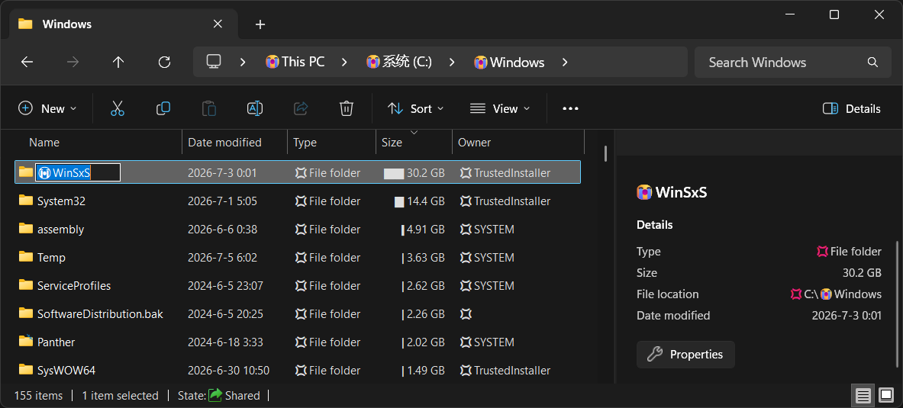

# [ib-shell](ib-shell/README.md)
[](https://crates.io/crates/ib-shell)
[](https://docs.rs/ib-shell)
[](LICENSE.txt)

Some desktop environment libraries, mainly for Windows Shell (Windows' built-in desktop environment).

## [ib-shell-item](ib-shell-item/README.md)
[](https://crates.io/crates/ib-shell-item)
[](https://docs.rs/ib-shell-item)
[](LICENSE.txt)

A library for operating file system files / Windows Shell items.

Features:
- Shell item ID list (path): `AbsoluteIDList`, `RelativeIDList`, `ChildID` and their `Ref` variants; `IPersistIDList` binding.
- Shell folder: `IShellFolder` binding.
- Shell item: `IShellItem`, `IShellItem2` bindings.
- Property System: `IPropertySystem`, `IPropertyStore`, `FSColumn` bindings.
- Hooking
  - Hook item display name.
  - Display folder size with bar graph from Everything.
- COM string utilities.

Hooking preview:  


## [ib-shell-verb](ib-shell-verb/README.md)
[](https://crates.io/crates/ib-shell-verb)
[](https://docs.rs/ib-shell-verb)
[](LICENSE.txt)

A library for handling of custom Windows Shell verbs (actions like `open`) and injecting them.

Features:
- Invoke verbs.
- Hook verbs.
- Open files in workspace for VS Code.

### CLI
- `ib-open-workspace`:
  Given a file path, open its parent folder (or Git root) and show the file in VS Code.

  For example:
  ```sh
  ib-open-workspace --vscode README.md
  ```
  Works on Windows and Linux.

  If you don't want a binary, there is also a
  [cmd + VBScript version](ib-shell-verb/OpenFileInWorkspace/OpenFileInWorkspace.vbs).

## See also
### Integrations
- [IbEverythingExt: Everything 拼音搜索, ローマ字検索, wildcard, quick select, Shell extension](https://github.com/Chaoses-Ib/IbEverythingExt)

### Related projects
- [ib-ime: A library for controlling input controls' IME (Input Method Editor) behavior on Windows](https://github.com/Chaoses-Ib/ib-input#ib-ime)
- [SharpShell: Make it easy to create Windows Shell Extensions using the .NET Framework.](https://github.com/dwmkerr/sharpshell)
